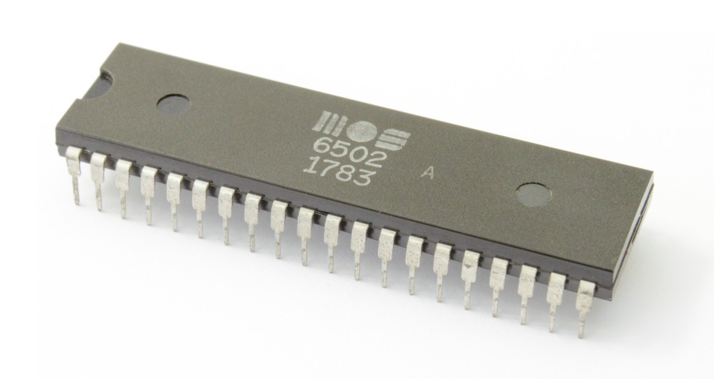

# 6502-TRANSFORMER

A tiny transformer with a full forward + backward pass, in assembly
only — for two vintage CPUs that were never meant to run one.

- **6502** — the MOS 6502 (Apple II, C64, NES).
- **AGC** — the Apollo Guidance Computer.

Same model, same task, two architectures. Ternary weights everywhere.
No Python. No C. No libraries. Just assembly.

## The model

d_model = 4, seq_len = 2, vocab = 4, 1 layer, 1 head, FFN = 4.
All weights ternary (-1, 0, 1). Task: tokens `[0, 1]` → predict token
`2`. Loss = MSE on the last token's logits. Training = SGD with latent
weights (update, clamp, re-quantize to ternary with a dead zone).

## How it works

**Forward:** embedding → Q/K/V (ternary dot products) → scores →
softmax → attention output → FFN + residual → logits → loss.

**Backward:** gradients through output → FFN (ReLU mask) → attention
(softmax Jacobian, dQ/dK/dV) → embedding, then the SGD update.

**Why ternary:** the 6502 has no multiply. The AGC has no multiply.
A ternary weight turns a dot product into add / subtract / skip:
`1` → add, `-1` → subtract, `0` → skip. No multiply needed.

## The architecture

Read [`docs/architecture.md`](docs/architecture.md) — about 1,000 words
on the 6502's architecture, the memory layout, and the little old
lady's syntax.

## Repo map

| Path | What it is |
|------|-----------|
| `6502/ternary_dot.asm` | The 6502 kernel — user-supplied ternary dot product, verbatim |
| `6502/forward.asm` | 6502 forward pass |
| `6502/backward.asm` | 6502 backward pass + SGD update |
| `6502/main.asm` | 6502 entry, init, data, training loop |
| `6502/math.asm` | 6502 helpers (MUL8, DOT8, softmax, quantize) |
| `agc/ternary_squib.asm` | The AGC kernel — user-supplied ternary squib, verbatim |
| `agc/forward.asm` | AGC forward pass |
| `agc/backward.asm` | AGC backward pass + SGD update |
| `agc/main.agc` | AGC entry, memory map, data, training loop |
| `docs/architecture.md` | Architecture, memory layout, syntax (~1,000 words) |

## Building

**6502** — ca65 syntax. Assemble + link (provide a config with `CODE`
at `$8000`, `VECTORS` at `$FFFA`), run on a 6502 emulator. Watch
`LOSS` (`$0304`).

**AGC** — yaAGC syntax. Assemble with yaAGC, run on an AGC emulator.

## Honest status

**Written, not executed.** No 6502 or AGC emulator on the build VM.
LayerNorm is omitted (documented). AGC embedding is frozen
(documented). Do not claim it runs until it has been assembled,
executed, and the loss decreases.

Photo: MOS 6502 chip, via the CBM Museum (cbmmuseum.kuto.de).

## License

SNAPKITTY OPAQUE SOURCE LICENSE v1.0. See `LICENSE`.
